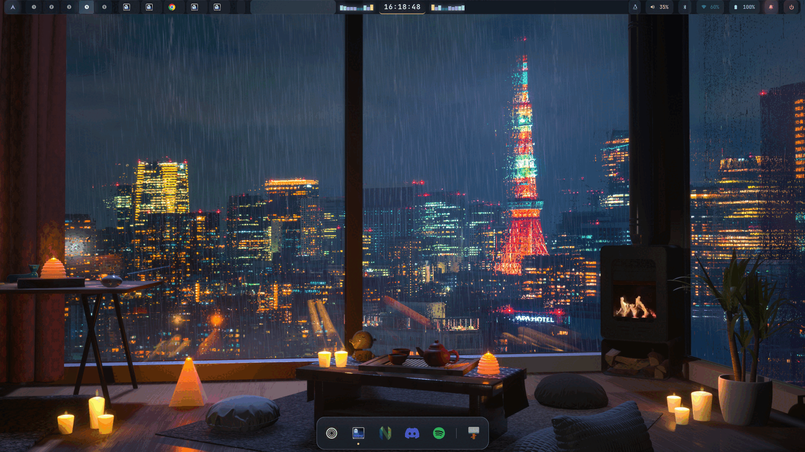
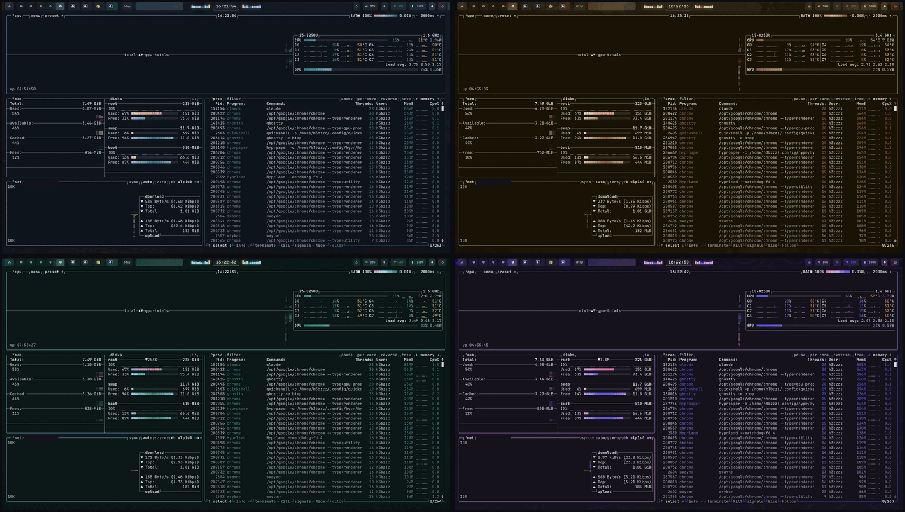
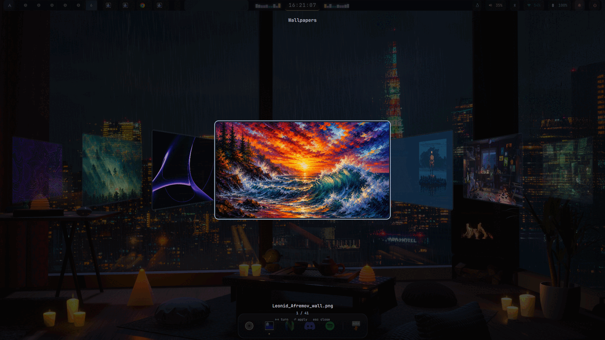
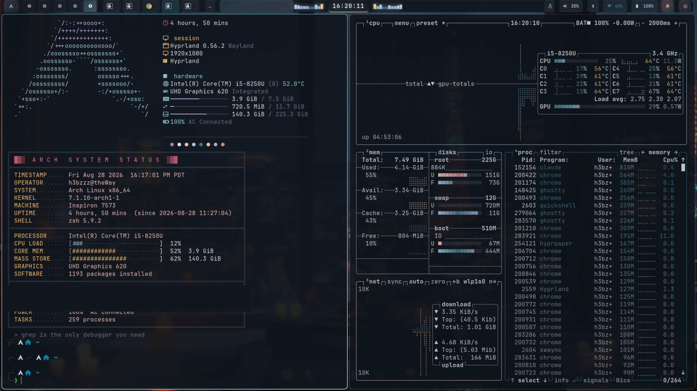

# h3bzzz's Hyprland rice

A Hyprland desktop where **the wallpaper is the theme**. Pick an image and the
bar, launcher, terminal, lock screen, notifications and system monitor are all
recoloured from it in one pass — not with a fixed palette that merely sits next
to the wallpaper, but with colours measured out of the image itself.



> Omarchy kept breaking on one of my desktops. I already had a Hyprland config
> I was building on my laptop and had grown used to, so I made it portable.
> Maybe someone else finds a use for it.

---

## The interesting part: wallpaper-driven theming

Everything visual is generated from one image by
[matugen](https://github.com/InioX/matugen) plus a small accent solver, then
written into twelve theme slots that every component reads.

```
 wallpaper
     │
     ├─ matugen  ──────────────►  structural slots
     │  (--source-color-index 0)   base surface overlay muted subtle text
     │
     └─ theme-accents.py ──────►  accent slots
        (image histogram)          love gold rose pine foam iris
                                        │
        ┌───────────────────────────────┴────────────────────────────┐
        ▼            ▼            ▼           ▼          ▼           ▼
     waybar        rofi        ghostty     hyprlock    swaync      btop
                             quickshell    hyprland              fastfetch
                                  │
        oh-my-posh   tmux   yazi  │  lazygit   atuin   nvim (rose-pine)
                                  │
                                  └─►  the 16 ANSI slots, which is how
                                       fzf, eza, bat, delta and LS_COLORS
                                       follow the wallpaper without a
                                       template of their own
                                       (config/zsh/shell-theme.zsh)
```

Eighteen files are generated from one image. `apply-theme.sh` rewrites them all
and reloads every consumer that supports it.

Two details are what make it actually match, and both were arrived at by
measuring the whole wallpaper library rather than by eye:

**The seed is the dominant colour, not the most saturated one.** matugen's
`--prefer saturation` picks the most *vivid* candidate, which in a photograph is
usually a minority detail — a neon sign, a lamp, a sunset edge. On a 36-image
library it landed on the wrong side of the colour wheel for **15 of 35** images:
a blue Tokyo Night wallpaper themed the entire desktop orange.
`--source-color-index 0` was wrong for **none** of them.

**Accents are assigned from the image, not interpolated toward it.** Rotating
each accent a fraction of the way toward the source hue lands it at a midpoint
that exists in neither the wallpaper nor the theme — the midpoint of pink→blue
is magenta. Instead `theme-accents.py` reads the image's real hue vocabulary
(ImageMagick histogram, weighted by area × saturation, merged into families) and
assigns slots to hues genuinely in the frame:

- the **dominant family owns the structural accents** (`iris`/`foam`/`pine`),
  fanned into an analogous chord so they read as three colours rather than one;
- a genuine secondary hue is spent on `rose` alone — one deliberate contrasting
  accent is a feature, three scattered ones are an accident;
- `love` (error) and `gold` (warning) stay **semantic**. They are re-hued only if
  the wallpaper actually has colour in the red/amber band, otherwise they
  harmonise within a 15° cap. A magenta "error" badge is a worse bar than an
  untinted one;
- lightness is taken verbatim from Rose Pine — that spread is the legibility
  contract, and no wallpaper gets a vote on it;
- every accent is lifted until it clears **3.0:1 contrast** against the generated
  background, because Rose Pine's lightnesses were chosen against Rose Pine's
  own base, not an arbitrary one.

Net effect over the library: accents sit **37% closer** to colours actually
present in the wallpaper, with zero regressions and no accent below the contrast
floor.

The same desktop under four wallpapers — nothing changed but the image. The bar,
the window chrome and every widget in `btop` follow it:



| wallpaper | `pine` accent |
| --- | --- |
| Tokyo Night (blue) | `#397587` |
| Gruvbox (warm) | `#8d583e` |
| Forest (green) | `#348c74` |
| Topographic (violet) | `#534ee2` |

Pick one with `SUPER + W`. The wheel is a Quickshell coverflow over
`~/Pictures/wallpapers`; scrolling costs nothing, and only committing a pick
re-derives the palette:



Re-theme at any time:

```bash
~/.config/hypr/scripts/apply-theme.sh          # from the current wallpaper
MATUGEN_SCHEME=scheme-content apply-theme.sh   # or override the scheme
```

---

## Components

| | |
| --- | --- |
| **Hyprland** | Lua-driven config (`hyprland.lua` + modular `lua/` includes) |
| **Waybar** | Centred clock flanked by cava audio-visualiser bars |
| **Quickshell** | App browser, session menu, and the coverflow wallpaper wheel |
| **Rofi** | Fullscreen grid launcher (type-3) + power menu (type-4) |
| **Ghostty** | Terminal, palette regenerated per wallpaper |
| **Hyprlock / Hypridle** | Lock screen; idle → screensaver → lock → DPMS → suspend |
| **Thornwatch** | Terminal screensaver — clock, vitals, recon and lore panels |
| **swaync** | Notification centre |
| **btop / cava / nvim / tmux** | Monitor, visualiser, LazyVim, multiplexer |
| **zsh** | oh-my-zsh, lazy nvm, wallpaper-tracking fzf/eza/bat/delta |
| **oh-my-posh** | Prompt, palette generated per wallpaper; p10k kept as fallback |
| **yazi / lazygit / atuin** | File manager (inline images), git TUI, history — all themed |
| **fastfetch** | Greeter drawn on every new shell; palette regenerated per wallpaper |



---

## Install

Target is **Arch Linux + Hyprland**. Other distros get a best-effort package
pass; the only AUR package is the optional `oh-my-posh-bin`.

```bash
git clone https://github.com/h3bzzz/h3bzzz-dotfiles ~/h3bzzz-dotfiles
cd ~/h3bzzz-dotfiles

./install.sh --deps    # packages, oh-my-zsh, p10k, plugins, then deploy
./install.sh           # deploy only

./install.sh --copy    # standalone: copy the configs, no symlinks
./install.sh --link    # tracked: symlink this repo into ~/.config
```

With neither `--copy` nor `--link`, an interactive run asks which you want.

Then `hyprctl reload`, `chsh -s $(which zsh)`, and run `nvim` once to let
LazyVim install its plugins.

### How the deploy works

Two modes. The choice only matters *after* the install.

**`--copy` — standalone.** Files are copied into `~/.config`. The rice is
yours: edit anything, delete the clone, the desktop keeps working. Nothing you
change ever touches this repo. Re-running `--copy` overwrites the copies (the
old ones are backed up first), so a pull-then-reinstall would discard local
edits — keep your own git repo if you want history. Wallpapers are merged into
`~/Pictures/wallpapers`, so your own images there survive a re-run.

**`--link` — tracked.** This repo is symlinked into `~/.config`:

```
~/.config/hypr  ->  ~/h3bzzz-dotfiles/config/hypr
~/.config/waybar -> ~/h3bzzz-dotfiles/config/waybar
~/Pictures/wallpapers -> ~/h3bzzz-dotfiles/wallpapers
...
```

So editing `~/.config/hypr/lua/binds.lua` **is** editing the repo. Every change
you make to the rice shows up in `git status` with nothing to sync back by
hand, and re-running is a no-op on paths that are already correct. This is the
mode to pick if you intend to track or contribute the rice.

Either way, anything already at those paths is moved to
`<name>.bak-<timestamp>` first. Nothing in the configs points at the clone —
every path resolves through `~/.config` and `~/Pictures/wallpapers` — so the
copy install has no hidden tie back to this repo.

### Generated files are not tracked

The twelve-slot palette is build output, regenerated whenever the wallpaper
changes. Tracking it would mean a commit per wallpaper switch, so `.gitignore`
excludes it and `install.sh` regenerates it. The *source* is
`config/matugen/templates/`.

A fresh clone therefore has no `colors.css` until `install.sh` (or
`apply-theme.sh`) has run once — waybar `@import`s it and will not start
without it.

### Secrets

`~/.config/zsh/secrets.zsh` is gitignored and sourced by `.zshrc`. Machine-local
API keys go there and never reach the repo. A `pre-commit` hook in `.githooks/`
blocks commits containing credential-shaped strings; `install.sh` enables it.

---

## Keeping it current: `rice`

`install.sh` gets a bare Arch box to a working desktop once. `rice` (symlinked
into `~/.local/bin` by the installer) is for every day after that.

| Command | What it does |
| --- | --- |
| `rice update` | Snapshot (snapper or timeshift, if present) → `git pull` → `pacman -Syu` → AUR → pending migrations → re-theme. Logged to `~/.local/state/rice/`. `--dry-run` shows what would happen. |
| `rice migrate` | Runs `migrations/*.sh` that have not run on this machine. Each brings an already-installed machine up to what a fresh install gives, runs once, and is recorded in `~/.local/state/rice/migrations/`. `--pending` only lists them. |
| `rice doctor` | Read-only health check: required commands, optional features, session services, config errors, theme outputs, pending migrations. |
| `rice backup [DIR]` | One passphrase-encrypted archive (gpg, AES256) of `~/.ssh`, `~/.gnupg`, `secrets.zsh`, `.gitconfig` and the installed-package lists. Written to `~/rice-backups` by default — **not** into this public repo. Extra paths go in `~/.config/rice/backup-paths`. |
| `rice restore FILE` | Lists the archive, asks, unpacks into `$HOME` and fixes key permissions. |

Bare box to "my machine again": `./install.sh --deps --link`, then
`rice restore /path/to/rice-backup-….tar.gz.gpg`.

Installer extras: `--extras=snapshots` sets up snapper + snap-pac on btrfs
(plus grub-btrfs when GRUB is the bootloader) or timeshift on other
filesystems; `--extras=recon` installs ProjectDiscovery's tools through their
own manager `pdtm`, with no AUR involved; `--extras=firewall` now applies a
deny-incoming / allow-outgoing policy instead of only enabling the service.

## Keybinds

`SUPER` is the mod key. Full list in `config/hypr/lua/binds.lua`.

| Key | Action |
| --- | --- |
| `SUPER + RETURN` | Terminal |
| `SUPER + Q` | Close window |
| `SUPER + R` | Launcher (rofi) |
| `SUPER + SPACE` | App browser (quickshell) |
| `SUPER + A` | Window switcher |
| `SUPER + W` | **Wallpaper wheel** — applying one re-themes everything |
| `SUPER + E` | File manager |
| `SUPER + V` | Toggle floating |
| `SUPER + Z` | Resize mode |
| `SUPER + H/J/K/L` or arrows | Focus direction |
| `SUPER + M` / `SUPER + SHIFT + M` | Toggle / move to scratchpad |
| `SUPER + grave` | **Drop-down terminal** — ghostty's native quick terminal |
| `SUPER + /` | **Keybind cheat sheet** — searchable, generated from the live binds |
| `SUPER + D` | **Control centre** — clock, CPU/RAM/disk, volume, Wi-Fi/Bluetooth and every toggle as a tile |
| `SUPER + X` | **Control menu** — the same toggles plus capture tools, as a searchable list |
| `SUPER + CTRL + E` | Eye candy — frost blur, wobbly windows, glow (off by default) |
| `SUPER + T` | Cycle this workspace's layout: dwindle → scrolling → monocle |
| `SUPER + TAB` | Next window on the workspace (`SHIFT` for previous) |
| `SUPER + SHIFT + F` / `SUPER + CTRL + F` | Fullscreen / maximize |
| `SUPER + CTRL + H/J/K/L` or arrows | Move window in a direction |
| `SUPER + ,` / `.` | Focus previous / next monitor (`SHIFT` moves the window there) |
| `SUPER + SHIFT + R` | Start / stop a screen recording (`~/Videos/recordings`) |
| `SUPER + SHIFT + T` | Copy text out of a screen region (OCR) |
| `SUPER + SHIFT + Q` | Scan a QR code on screen |
| `SUPER + ;` / `SUPER + C` | Emoji picker / calculator |
| `SUPER + SHIFT + N` | Night light (also automatic from 20:00, `hyprsunset.conf`) |
| `SUPER + CTRL + G` | Game mode — no animations, blur, shadows or gaps |
| `SUPER + CTRL + I` / `P` / `N` | Caffeine / cycle power profile / do not disturb |
| `y` (shell) | yazi file manager; quitting leaves the shell in that directory |
| `SUPER + N` | Notification panel |
| `SUPER + SHIFT + V` | Clipboard history |
| `SUPER + SHIFT + C` | Pick colour to clipboard |
| `Print` / `SUPER + Print` | Screenshot output / region |
| `SUPER + SHIFT + Print` | Screenshot + annotate (satty) |
| `SUPER + SHIFT + L` | Lock screen |
| `SUPER + CTRL + ESCAPE` | Toggle screensaver |
| `SUPER + ESCAPE` | Session menu |
| `SUPER + SHIFT + E` | Exit Hyprland |

Browser and tool launchers (`B` Zen, `F` Firefox, `G` Chrome, `Y` VS Code,
`U` Cursor, `I` Burp Suite, `O` Caido) are personal — edit `binds.lua` freely.

---

## Shell

`zsh` + oh-my-zsh + powerlevel10k. Startup is ~275ms; it was ~1.3s before
`nvm` was made lazy (`zstyle ':omz:plugins:nvm' lazy yes`), which alone
accounted for 811ms of it. p10k's instant prompt runs in `quiet` mode and is
placed *after* the fastfetch greeter, since instant prompt only forbids console
output that comes after it.

Colours come from `config/zsh/shell-theme.zsh`, which sets `FZF_DEFAULT_OPTS`,
`EZA_COLORS`, `LS_COLORS` and `BAT_THEME` against **ANSI slot numbers** rather
than literal hex. matugen already fills those 16 slots from the wallpaper via
`config/matugen/templates/ghostty-theme`, so the shell follows the desktop with
nothing extra to regenerate — and still degrades sanely over SSH or in tmux.
`BAT_THEME=ansi` is the same trick: bat's `ansi` theme draws only from the
terminal palette, so it tracks the wallpaper where a named theme would pin it.

### Prompt

`oh-my-posh`, configured by `config/matugen/templates/omp.json`. powerlevel10k
is still installed and `.zshrc` falls back to it when oh-my-posh is missing, so
a machine without it still gets a prompt.

The move off p10k was not about speed. p10k's README states the project has very
limited support, no new features, and that most bugs will go unfixed. Measured
on this machine, the three options land within 45ms of each other for time to a
visible prompt (oh-my-posh 262ms, starship 254ms, p10k 298ms) — p10k's instant
prompt stopped paying for itself once `nvm` was made lazy. What actually decided
it was that a p10k theme is 1700 lines of hardcoded 256-colour indices, while
oh-my-posh resolves a dozen named palette colours, which is what lets the prompt
follow the wallpaper at all. oh-my-posh over starship because its zsh transient
prompt is native rather than a community hook with known Ctrl+C issues.

One wrinkle worth knowing: matugen and oh-my-posh both use `{{ }}`, so
oh-my-posh's Go template expressions are backslash-escaped in the matugen
template. Edit the template, never the generated `config.json`.

### Ghostty

| Key | Action |
| --- | --- |
| `SUPER + grave` | Drop-down terminal (ghostty quick terminal) |
| `CTRL + SHIFT + ENTER` / `-` | Split right / down |
| `CTRL + SHIFT + H/J/K/L` | Focus split |
| `CTRL + SHIFT + Z` | Zoom split |
| `CTRL + SHIFT + F` | Search scrollback (`F3` / `SHIFT + F3` next / previous match) |
| `CTRL + SHIFT + PageUp/Dn` | Jump to previous / next prompt |
| `CTRL + SHIFT + O` | Write scrollback to a file and open it (`CTRL + ALT + SHIFT + O` types the path instead) |
| `CTRL + SHIFT + R` | Resize mode: `h/j/k/l` resize the split, `SHIFT` for big steps, `e` equalize, `ESC` leaves |
| `CTRL + SHIFT + S` | Scroll mode: `j/k` line, `d/u` half page, `g/G` top/bottom, `[`/`]` prompts, `/` search, `ESC` leaves |
| `CTRL + SHIFT + P` | Command palette |

A command that runs longer than 30s in an unfocused surface raises a swaync
notification (`notify-on-command-finish`), which is aimed at long `nuclei`,
`subfinder` and `zig build` runs.

The drop-down is ghostty's own quick terminal: a layer surface that drops from
the top of whichever monitor the pointer is on, living in the main ghostty
process. `SUPER + grave` is a Hyprland bind that runs
`ghostty +toggle-quick-terminal`, which goes over D-Bus and so works with no
ghostty window open. Size and position are the `quick-terminal-*` keys in
`config/ghostty/config`.

`ssh` is wrapped by ghostty's shell integration (`ssh-env`) so remote hosts see
`TERM=xterm-256color`. Nothing is installed remotely; for a host you own,
`ghostty +ssh --terminfo user@host` installs the terminfo entry once.

---

## Layout

```
h3bzzz-dotfiles/
├── install.sh              # copy/symlink deploy + package bootstrap
├── .githooks/pre-commit    # credential guard
├── assets/                 # screenshots for this README
├── wallpapers/             # bundled wallpapers + CREDITS.md
└── config/
    ├── hypr/               # hyprland.lua, lua/, scripts/, thornwatch/, lock + idle
    │   ├── scripts/apply-theme.sh      # the theming pipeline
    │   └── scripts/theme-accents.py    # accent solver
    ├── matugen/            # config.toml + templates/  <- palette source of truth
    ├── waybar/  quickshell/  rofi/  wofi/  swaync/
    ├── ghostty/  cava/  btop/  nvim/  tmux/
    └── zsh/                # .zshrc + .p10k.zsh (linked into $HOME)
```

---

## Customising the theme

Change a **component's** colours by editing its template in
`config/matugen/templates/` — never the generated file, which is overwritten on
the next wallpaper change.

Change **how accents are derived** in `config/hypr/scripts/theme-accents.py`:
`ANCHORS` sets each slot's base hue and semantic window, `SAT_PULL` how far
saturation follows the wallpaper, and `CONTRAST_FLOOR` the legibility minimum.

Change the **scheme** with `MATUGEN_SCHEME`. The default is `scheme-vibrant`;
`scheme-content` produces noticeably greyer surfaces (mean saturation 0.105 vs
0.184 across the library), which is why it is not the default.

---

## Requirements

Installed by `./install.sh --deps`.

**Repo:** hyprland, hyprpaper, hyprlock, hypridle, xdg-desktop-portal-hyprland,
waybar, quickshell, rofi, rofi-emoji, rofi-calc, wofi, swaync, hyprsunset,
hyprshutdown, wf-recorder, tesseract, zbar, ghostty, cava, btop, neovim, tmux,
imagemagick, jq, python, socat, cliphist, wl-clipboard, grim, slurp,
brightnessctl, playerctl, pavucontrol, wireplumber, blueman, networkmanager,
matugen, thunar, papirus-icon-theme, ttf-jetbrains-mono-nerd, noto-fonts-emoji, zsh

**AUR:** `oh-my-posh-bin` only (optional; a binary fallback exists). `matugen`
now comes from the official repos.

**pipx:** [`terminaltexteffects`](https://github.com/ChrisBuilds/terminaltexteffects)
for the screensaver.

`imagemagick` is not optional: the accent solver reads the wallpaper's histogram
through `convert`.

---

## Credits

- [Rose Pine](https://rosepinetheme.com/) — the palette structure the twelve
  slots are built on
- [Hyprland](https://hyprland.org/), [matugen](https://github.com/InioX/matugen),
  [Quickshell](https://quickshell.outfoxxed.me/),
  [Neovim](https://neovim.io/), [oh-my-zsh](https://ohmyz.sh/),
  [Powerlevel10k](https://github.com/romkatv/powerlevel10k)
- [z.lua](https://github.com/skywind3000/z.lua) — directory jumping that learns
  your habits; worth having in any shell
- Wallpapers are third-party; see [`wallpapers/CREDITS.md`](./wallpapers/CREDITS.md)

Code in this repo is MIT (see `LICENSE`). The bundled wallpapers are **not**
covered by it — rights remain with their artists.
